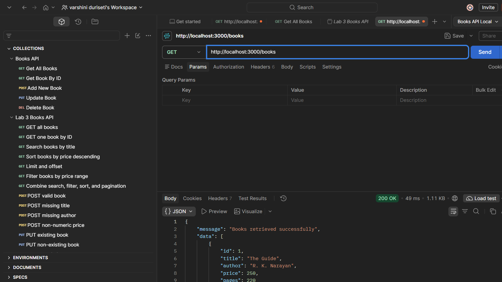
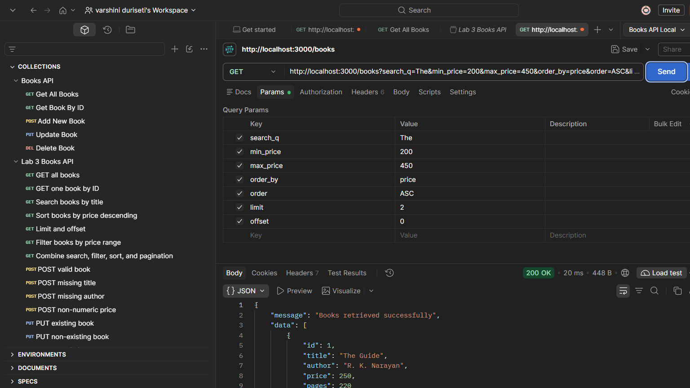
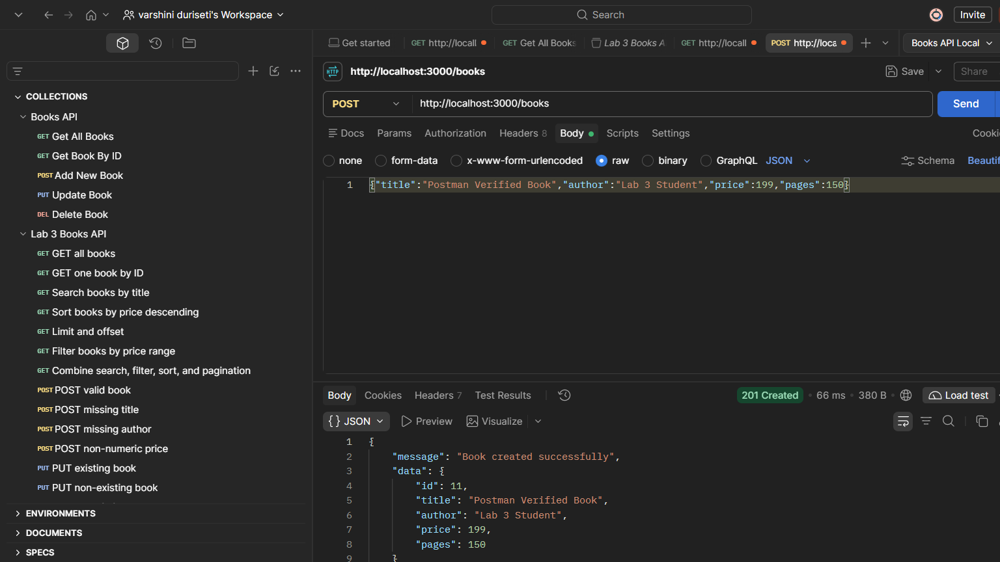
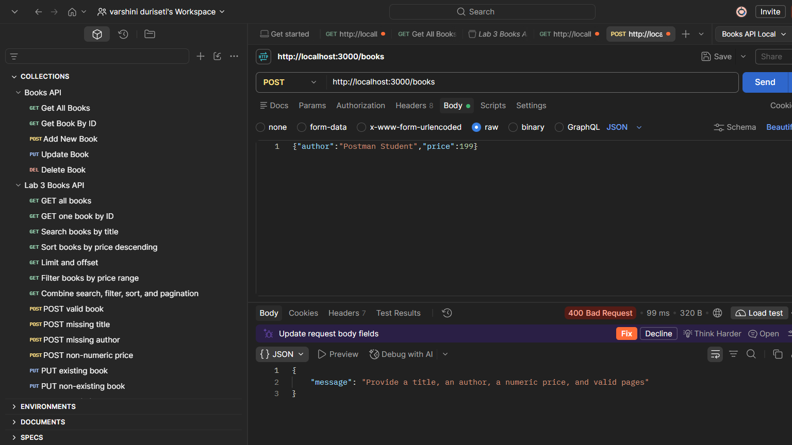

# Lab 3: REST API, Query Parameters, Validation and Debugging

**Vercel deployment:** [varshini-duriseti-labreport3-bdf.vercel.app](https://varshini-duriseti-labreport3-bdf.vercel.app/)

**Subject:** Backend Development Fundamentals · Year II Term II · Aurora

## Student details

| Detail | Value |
|---|---|
| Name | DURISETI VARSHINI |
| Registration Number | 252U1R5040 |
| Class/Section | CSE-AIDE-2A/106 |
| Faculty | Mr Sai Siva Teja Chintakrindi |
| Subject | Backend Development Fundamentals |
| Institution | Aurora |

> **Faculty name reminder:** The assignment DOCX lists “Joel Prashanth D”, while the supplied student details give “Mr Sai Siva Teja Chintakrindi”. The name above follows the supplied student details. Please verify the correct faculty name before submission. The two-page assignment DOCX was reviewed page by page and its requirements were checked against this README.

**Lab number:** Lab 3  
**Lab title:** REST API, Query Parameters, Validation and Debugging

## Lab information

- **Content week:** Week 3, slots 13–19
- **Module:** RESTful API development and validation
- **Suggested duration:** About 100 minutes (two back-to-back periods)
- **Prerequisite:** Lab 2

## Objective

Turn the Lab 2 book routes into a REST API with title search, sorting, price filtering, pagination, validation, correct status codes, and practice debugging common errors.

The code uses straightforward route handlers, `if` checks, arrays, and SQL parameters so the steps are easy to follow and explain.

## Technologies

- Node.js and Express.js
- SQLite with `sqlite3` and the promise-based `sqlite` wrapper
- JavaScript `async`/`await`
- Postman collection and local environment for manual API testing

## Project structure

```text
lab-03/
├── app.js
├── api.js
├── books.db
├── package.json
├── package-lock.json
├── schema.sql
├── seed.js
├── seed.sql
├── README.md
├── VIVA.md
├── postman/
│   ├── collections/
│   │   └── Lab 3 Books API.postman_collection.json
│   └── environments/
│       └── Lab 3 Local.postman_environment.json
├── screenshots/
│   ├── postman-get-all.png
│   ├── postman-search-filters.png
│   ├── postman-post-success.png
│   └── postman-post-validation-error.png
└── test/
    ├── api.test.js
    └── vercel.test.js
```

`books.db` is a separate Lab 3 database. The Lab 2 project and its database were not modified.

## Installation and database setup

Open a terminal in this `lab-03` directory and run:

```sh
npm install
npm run db:seed
```

`npm run db:seed` creates the `book` table from `schema.sql` and inserts the sample rows from `seed.sql`. The inserts use `INSERT OR IGNORE`, so rerunning the seed command does not duplicate the original sample IDs.

## Run the API

```sh
npm start
```

The local server listens at `http://localhost:3000` by default. To use another port, set the `PORT` environment variable before starting the server. If the port is occupied, stop the other process or select another port.

## Vercel deployment

Vercel uses `app.js` as the Express application entry point. It opens an in-memory SQLite database and loads the 10 sample books from `seed.sql`, because Vercel function files are read-only and the local `books.db` cannot be used for writes there. This makes the API routes available online, but changes made with POST, PUT, or DELETE are temporary and can reset when Vercel starts a new function instance. The local `npm start` script runs `api.js` and continues to use `books.db` and keep its changes.

## API endpoints

| Method | Endpoint | Purpose | Example query parameters |
|---|---|---|---|
| GET | `/books` | List books with optional search, filtering, sorting, and pagination | `search_q=Guide&order_by=price&order=DESC&limit=5&offset=0&min_price=100&max_price=500` |
| GET | `/books/:bookId` | Get one book by ID | — |
| POST | `/books` | Create a book | JSON body |
| PUT | `/books/:bookId` | Replace a book's details | JSON body |
| DELETE | `/books/:bookId` | Delete a book | — |

### GET `/books` parameters

| Parameter | Default | Rules |
|---|---|---|
| `search_q` | Empty string (no title search) | Partial title match using parameterized SQL `LIKE` |
| `order_by` | `id` | One of `id`, `title`, `author`, `price`, or `pages` |
| `order` | `ASC` | `ASC` or `DESC` (case-insensitive) |
| `limit` | `10` | Whole number from 1 through 100 |
| `offset` | `0` | Non-negative whole number |
| `min_price` | No lower bound | Non-negative number |
| `max_price` | No upper bound | Non-negative number; must not be less than `min_price` |

All filters can be combined. Query values are bound as SQL parameters. The sort column and direction are checked before being used in the SQL statement.

## Request examples

Search and sort:

```http
GET http://localhost:3000/books?search_q=The&order_by=price&order=DESC
```

Filter and paginate together:

```http
GET http://localhost:3000/books?min_price=200&max_price=450&limit=5&offset=0
```

Create a book:

```http
POST http://localhost:3000/books
Content-Type: application/json

{
  "title": "Sample Book",
  "author": "Sample Author",
  "price": 199,
  "pages": 150
}
```

Update a book (title, author, and numeric price are required; pages is optional):

```http
PUT http://localhost:3000/books/1
Content-Type: application/json

{
  "title": "Updated Sample Book",
  "author": "Sample Author",
  "price": 220,
  "pages": 160
}
```

## Responses, validation, and status codes

Successful list response:

```json
{
  "message": "Books retrieved successfully",
  "data": [
    {
      "id": 1,
      "title": "The Guide",
      "author": "R. K. Narayan",
      "price": 250,
      "pages": 220
    }
  ]
}
```

Successful create response (`201`):

```json
{
  "message": "Book created successfully",
  "data": {
    "id": 11,
    "title": "Postman Verified Book",
    "author": "Lab 3 Student",
    "price": 199,
    "pages": 150
  }
}
```

Validation error (`400`):

```json
{
  "message": "Provide a title, an author, a numeric price, and valid pages"
}
```

This error is returned, for example, when `title` is missing:

```json
{
  "author": "Postman Student",
  "price": 199
}
```

Missing record (`404`):

```json
{
  "message": "Book not found"
}
```

The API requires non-empty title and author values and a non-negative numeric price. If supplied, `pages` must be a positive whole number. Malformed JSON and invalid query parameter values also return a JSON `message`.

The expected result is an API that supports search, sorting, price filters, and pagination, and returns the appropriate status code for success or failure.

| Status | Meaning in this API |
|---|---|
| `200` | Successful GET, PUT, or DELETE |
| `201` | Book created |
| `400` | Invalid request body or query parameters |
| `404` | The requested book ID does not exist |
| `500` | Unexpected database or server error |

## Debugging exercises

1. **Port conflict (`EADDRINUSE`):** Another process is listening on the requested port. Stop it or use another `PORT`.
2. **Wrong import path:** Verify the relative path and exact filename/casing so Node.js can find the module.
3. **Table-name typo:** The database table is `book` (singular). Use that name consistently in SQL.
4. **Missing `await`:** Await database calls before depending on their results; otherwise code can receive a Promise instead of completed query data.

The final application contains working routes rather than intentionally broken examples. Short viva explanations are in [VIVA.md](./VIVA.md).

## General lab rules

- `.env` and `node_modules/` are excluded from the submission.
- This project has no password fields and does not store or log passwords.
- SQL values use parameterized queries. Sorting uses an allowlist instead of accepting arbitrary SQL.
- Routes use success and failure status codes described above.

## Postman test list

Import these files into Postman:

- Collection: `postman/collections/Lab 3 Books API.postman_collection.json`
- Environment: `postman/environments/Lab 3 Local.postman_environment.json`

The collection has 15 requests covering GET all, GET by ID, search, sorting, pagination, price filtering, combined query parameters, valid POST, missing title, missing author, non-numeric price, valid PUT, missing-ID PUT, valid DELETE, and missing-ID DELETE. The create request stores its new ID in the environment for the following update and delete requests.

The Node.js integration tests passed. The Postman CLI collection run passed all 15 requests and 16 assertions with no failures. The Postman CLI could not publish run details to Postman cloud because it is not logged in.

The following are genuine screenshots captured from Postman desktop after sending requests to the local API:

### GET all books — 200 OK



### Combined search, price filter, sorting, and pagination — 200 OK



### Create a valid book — 201 Created



### Invalid POST with missing title — 400 Bad Request



The Postman collection also checks missing-ID PUT and DELETE responses as `404`; those cases passed in the CLI collection run. A separate genuine Postman desktop screenshot of a `404` response has not yet been added, so the existing screenshots do not document that response.

## Suggested evaluation

- Working output: 50%
- Code quality: 20%
- Testing evidence (Postman screenshots or collection): 15%
- Viva: 15%

## Learning outcome and conclusion

This lab demonstrates how REST routes use nouns and HTTP methods, how query parameters search and shape a list, and how validation and HTTP status codes communicate success or failure. SQL values use parameterized placeholders, while sorting is limited to allowed column names and directions. The debugging notes cover port conflicts, import paths, table names, and asynchronous database calls.
